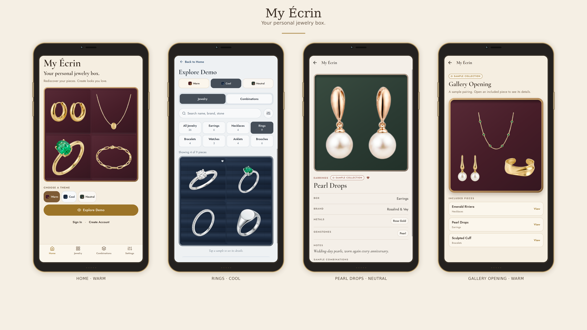
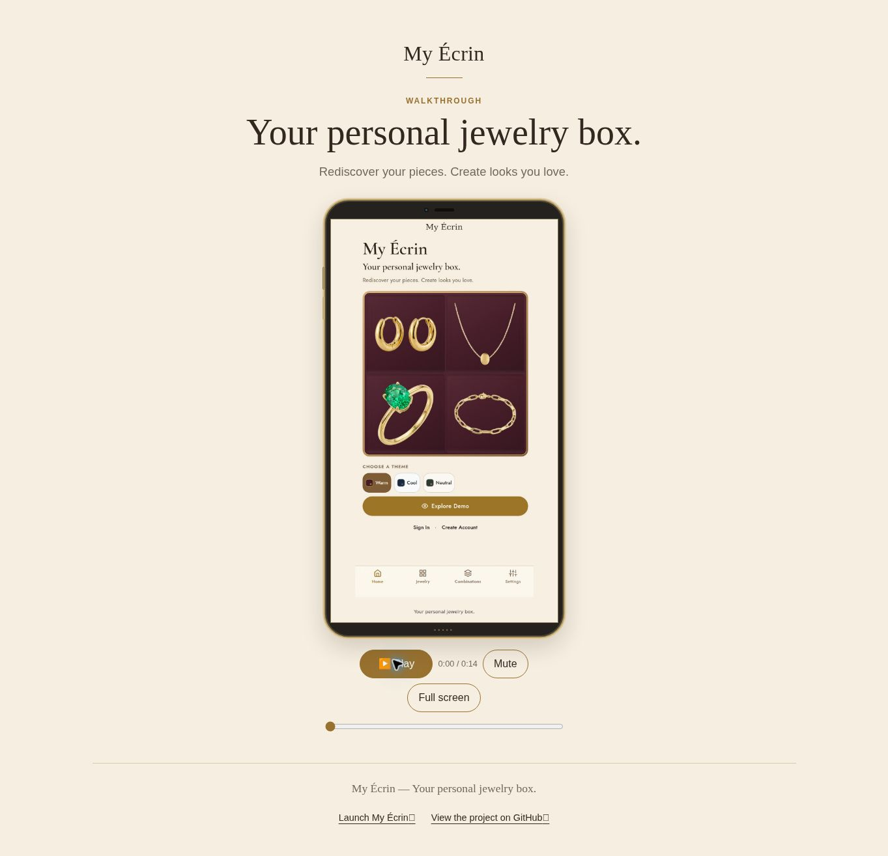

# 💍 My Ecrin
## 🎯 Objective  
This project is a personal digital jewelry box where treasured pieces can be beautifully organized, rediscovered, and styled into everyday combinations. Bringing together Replit, ChatGPT, and Vercel, it blends practical collection management with the intimate, elegant feel of opening a keepsake box.
## 🛠️ Tools  
Replit, ChatGPT, Vercel 

## ⚙️ Model  
Replit Free, Replit Power, ChatGPT 6.1 Sol 

## 📱 App  
This project is a fully functional app available at the following link: [Launch App](https://my-ecrin.vercel.app/) 

## 🎥 Video  
This project is a fully functional video available at the following link: [Watch Video](https://redefiningvicky.github.io/My-Ecrin/) 

